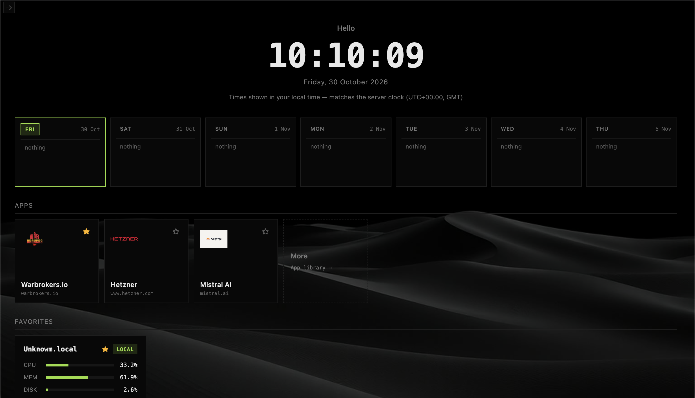

# ServerHub

A self-contained personal server dashboard. **One Go binary** — no external daemon, no Node.js, no Docker required to run it.

Open a browser and see all your Linux servers (and the machine running ServerHub) at a glance: live stats, Docker containers, full terminals, quick actions, and schedules — all from one place.



- **Single static binary.** The whole UI is embedded; config is a handful of readable YAML files.
- **SSH only.** ServerHub reaches your servers over the SSH connection you already trust — nothing is installed on them.
- **Yours.** Self-hosted, single-user, no accounts, no telemetry, no cloud.

---

## Quick start

### 1. Prepare your SSH access

Generate a key if you don't have one, and authorise it on each server:

```sh
ssh-keygen -t ed25519 -C "serverhub"
ssh-copy-id -i ~/.ssh/id_ed25519 user@192.168.1.10
```

Docker container management is optional; the SSH user needs permission to
talk to the Docker daemon (add them to the `docker` group):

```sh
sudo usermod -aG docker $USER   # log out and back in for this to take effect
```

ServerHub invokes `docker` directly (not through `sudo`), so a NOPASSWD
sudoers rule for `/usr/bin/docker` alone is not enough. Without Docker access,
an empty container list is shown instead of an error.

### 2. Build and run

```sh
git clone <repo>
cd serverhub/go

go build -o ../serverhub .   # the Go module lives in go/
cd ..
./serverhub
```

The frontend is embedded in the binary — nothing else to serve or install.

### 3. Set it up

On first launch the browser opens a short setup wizard (run locally, it asks
your name and whether you want a password — one recommendation: yes), then
the dashboard. Add your servers on the **Servers** page or in `servers.conf`.

Config lives in the OS config directory (`~/Library/Application
Support/ServerHub` on macOS, `~/.config/ServerHub` on Linux,
`%AppData%\ServerHub` on Windows) — a commented example for every file is in
[`docs/examples/`](docs/examples/).

---

## What you get

| | |
|---|---|
| **Dashboard** | Live CPU / memory / disk cards for every server plus the local machine, 5s polling, sparkline history, your-week schedule strip |
| **Server pages** | Cached system info, capability probes (tmux, docker, rsync, sftp, sudo, iperf3), disks, load |
| **Terminals** | Full PTY terminal via xterm.js over WebSocket — vendored locally, works offline. Same for the machine running ServerHub |
| **Docker** | Start / stop / restart containers, image list, live container logs — remote and local |
| **Quick actions** | Runbook buttons with inline output; `mode: detached` tmux jobs with observe / attach / stop / dismiss |
| **Schedules** | Recurring or one-off commands and quick actions across servers and tags, on a month/hour calendar with run-now and honest history |
| **Probes** | On-demand ping (both directions), DNS, HTTP, traceroute, and a 5-second iperf3 bandwidth test |
| **Comfort** | Favorites, persistent server URLs, server search (`Cmd/Ctrl+L`), reboot/shutdown confirmations, accent colour + shade theming, in-app audit log of every mutating action |
| **Security** | Optional bcrypt password auth, brute-force lockout, XSS-safe frontend, TOFU-pinned SSH host keys |

---

## Documentation

| Doc | Contents |
|---|---|
| [`docs/CONFIGURATION.md`](docs/CONFIGURATION.md) | Full reference: `config.yaml`, `servers.conf`, quick actions, schedules |
| [`docs/SECURITY.md`](docs/SECURITY.md) | First-run wizard, password protection, network exposure, SSH host keys, file permissions |
| [`docs/examples/`](docs/examples/) | Annotated config examples to copy from |
| [`docs/design-jobs-scheduler.md`](docs/design-jobs-scheduler.md) | Design decisions: connection model, tmux jobs, scheduler, probes |
| [`docs/security-audit.md`](docs/security-audit.md) | The full security threat model and audit |

---

## Security in one paragraph

The default bind is `127.0.0.1` — only your machine can reach the dashboard.
Every request passes a host/origin guard that blocks DNS-rebinding and
cross-site requests. With a password set, sessions are 30-day cookies and
brute force is throttled; without one, the instance is protected by the same
guards but anybody who can *reach* the port can use it — so only expose a
bind beyond loopback inside an encrypted overlay (e.g. your Tailscale tailnet,
`bind: "100.x.y.z"`), and never bind `0.0.0.0`. SSH host keys are
pinned on first use and change is treated as an error, not a warning. Details
in [`docs/SECURITY.md`](docs/SECURITY.md).

---

## Building for other platforms

`build.sh` cross-compiles static binaries to `dist/` for 8 targets
(linux/darwin/windows, amd64/arm64); `resources/icon.png` is used for the
platform icons. `release.sh vX.Y.Z` packages everything into a tagged GitHub
release with checksums (releases are made from a clean, pushed default
branch). For development see `dev` (`./dev run` builds a sandboxed
instance on port 7080 that never touches your real config).

---

## Status

Personal project, in beta. It is **not** a SaaS and has no multi-user model —
one person manages their own servers. Issues and feedback very welcome.

Licensed under the [MIT License](LICENSE).